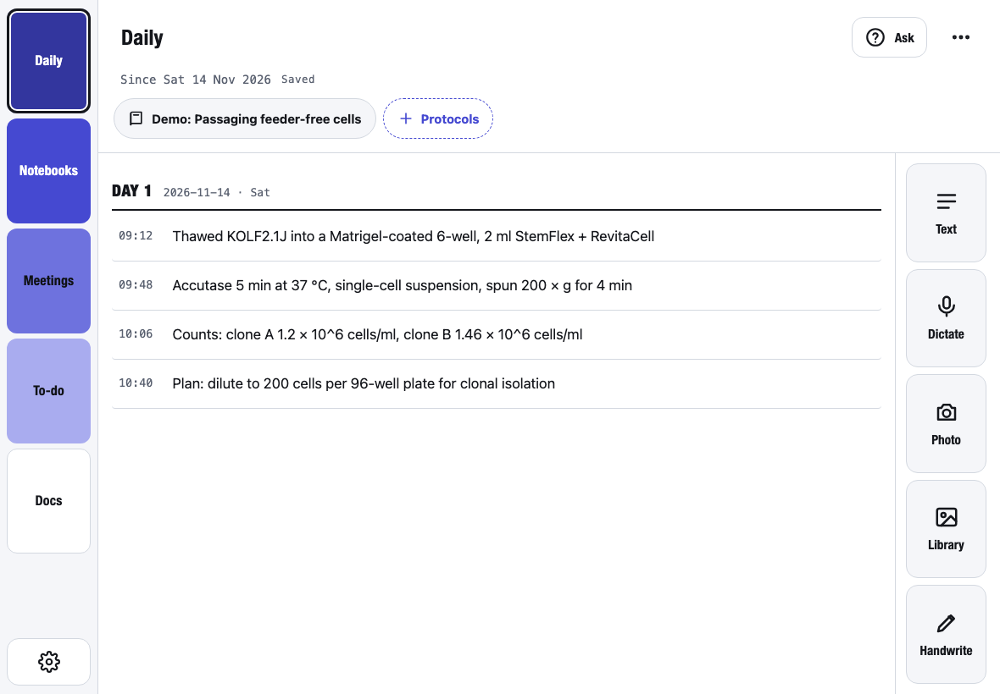
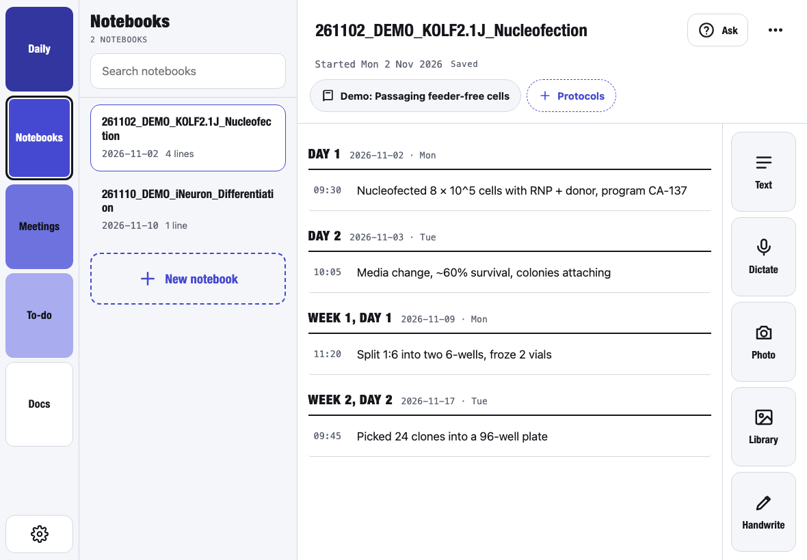
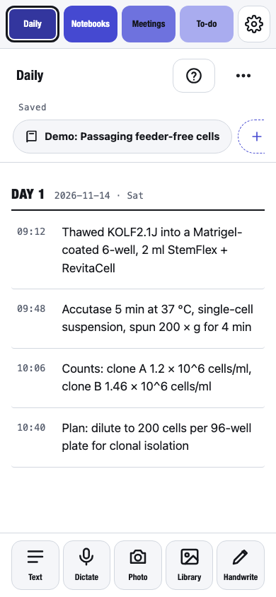
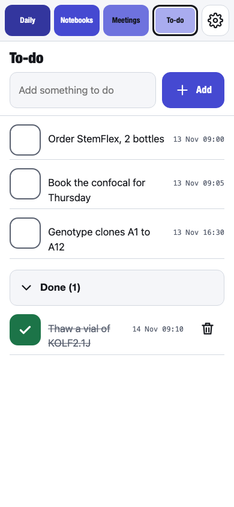
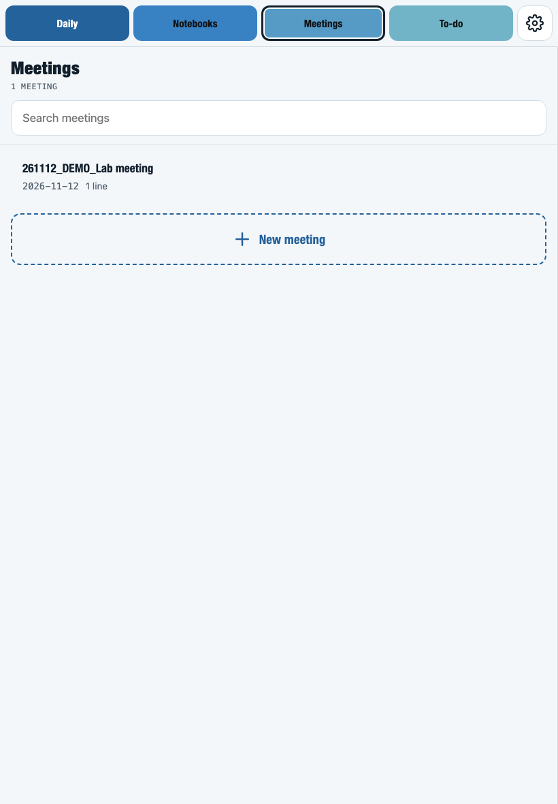
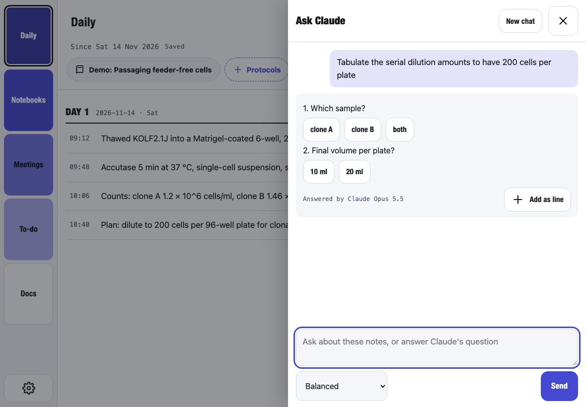
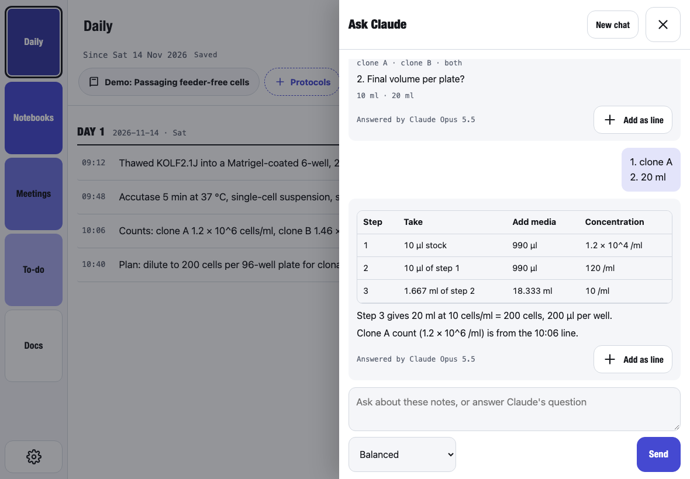

# ATG ELN

A bench notebook for iPad and iPhone. You record line by line while you work: typed or dictated text, photos and Apple Pencil handwriting. Each line is timestamped and grouped by day. Claude is built in for fixing dictated lab terms and answering questions about your notes.

It is a single web page that runs as a private [Claude artifact](https://claude.ai), so there is no server to set up. Your notes live in your own Claude account and nowhere else.

## Demo

These screenshots use made-up data (`node demo/make-demo.mjs` regenerates them).

| Daily on iPad | A notebook on iPad |
|---|---|
|  |  |

| Daily on iPhone | To-do on iPhone | Meetings, iPad portrait (Tide theme) |
|---|---|---|
|  |  |  |

**Ask asks before it assumes.** When a question depends on something the notes don't settle, Claude asks, and you answer with a tap:



Then it answers to the point, with numbers you can check:



## What it does

Five tabs:

- **Daily.** The home view: one running log. Open the app and add lines straight away, with large buttons for gloved hands. Everything in Daily is waiting to go to Benchling.
- **Notebooks.** One notebook per Benchling entry, with the same name, so you can see what was done without opening Benchling. Lines can be edited, and moved or copied to another notebook. Headers count from the notebook's first line: Day 1 to Day 7, then Week 1, Day 1 and so on.
- **Meetings.** A list of meetings, each with its own lines. They are not sent to Benchling unless you ask.
- **To-do.** One plain list. Ticked items fold into a Done section in the order you ticked them.
- **Docs.** For now, your protocol library to read. On narrow screens, slide the tab row sideways to reach it.

And in every place you write:

- **Dictation with Fix terms.** Phone and tablet dictation mishears lab words. Fix terms matches what was written against your vocabulary by sound, asks you about words it is unsure of, and learns from the corrections you accept.
- **Ask.** A chat per place (Daily, each notebook, each meeting). Claude sees all its lines and linked protocols, can look up your other protocols and notebooks, and asks short questions instead of guessing.
- **Photos and handwriting.** Take photos, or write with Apple Pencil; handwriting can be transcribed.
- **Themes.** Default, Tide, Bloom, Saffron and Meadow in Settings, each in light and dark.

## Get your own copy

You need a Claude account. Each person publishes their own copy, so notebooks are never shared.

1. Clone this repository and open the folder in Claude Code (or any Claude session that can publish artifacts).
2. Ask Claude: *"Publish `src/index.html` as a new private artifact called ATG ELN, with the capabilities db, user, assets, sample (with images) and dictation."*
3. Optional, to start with a stem-cell and molecular-biology vocabulary: *"Load the terms in `data/glossary.json` into this artifact's database as the document `config/glossary`, shaped `{ "terms": [...] }`."* You can also add terms yourself in the app's Settings.
4. Optional, protocols: each one is a document `protocols/<id>` shaped `{ "title", "category", "kind": "protocol", "text" }`. Protocols are not included in this repository.
5. Open the artifact link in Safari on your iPad or iPhone, then Share → Add to Home Screen.

These steps have not been tried from scratch on a second account yet; please open an issue if one of them fails.

## Moving notes to Benchling

The app records; a Claude session does the transfer. Open a Claude Code session in this folder and say **"Transfer my notes to Benchling."** The project instructions load by themselves (`CLAUDE.md` pulls in `project-instructions.md`), so there is nothing to paste. Claude reads the Daily log from your ATG ELN artifact, writes it into your Benchling notebook through the browser and uploads the photos. Once the text is confirmed in Benchling it moves those lines, unchanged, out of Daily and into the notebook named like the Benchling entry (creating the notebook if there is none), so Daily shows only what is left.

- The first time, Claude asks for your Benchling address, project and the email account to search, and saves them in `CLAUDE.local.md`, which stays on your machine.
- You must be signed in to Benchling in the browser Claude uses; it never types credentials.
- `scratch/` is working space for these sessions, for example copies of transferred photos. Its contents are never committed.
- If you use a Claude chat project instead of Claude Code, paste `project-instructions.md` into the project's custom instructions.

The instructions come from one person's working setup and Benchling layout; expect to adjust the template and naming sections to yours.

## Working on it

```bash
npm run setup   # once: installs Playwright and its browser
npm test
```

The whole app is `src/index.html`. The tests run it against a stand-in for the Claude runtime (`tests/mock-claude.mjs`), so they need no account and no network. Camera, microphone, Apple Pencil pressure and real Claude answers can only be checked on a device.

## Privacy

This repository holds the app, its tests, a vocabulary list and the project instructions. It contains no notes, no protocols and nobody's personal settings.
